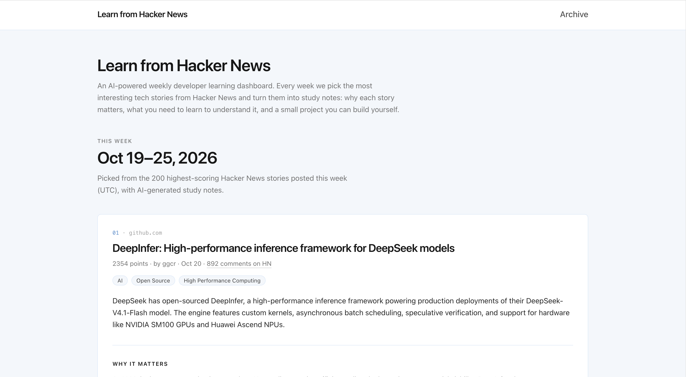
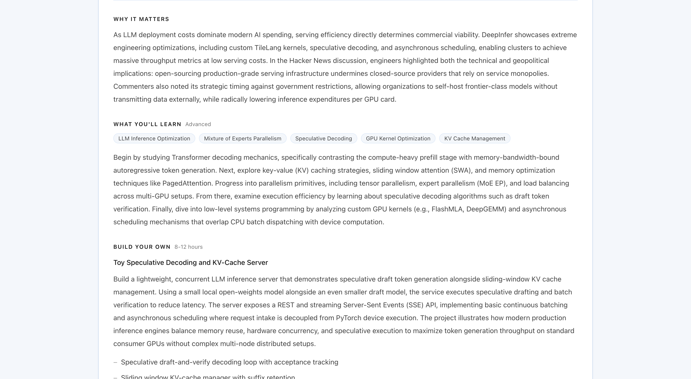
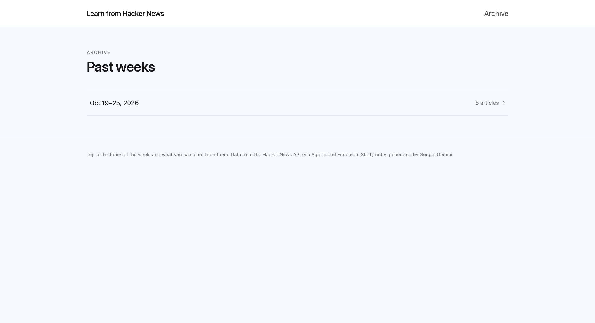
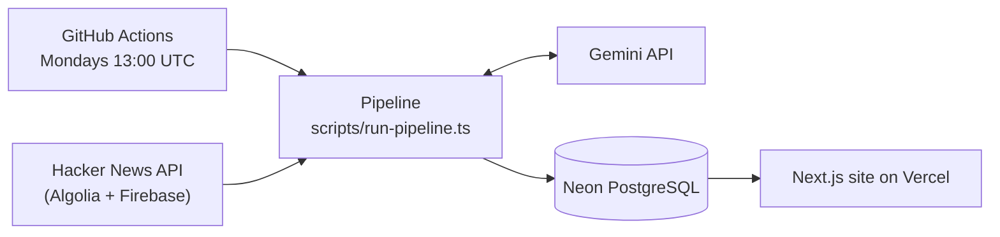

# Learn from Hacker News

An AI-powered weekly developer learning dashboard that turns the week's top Hacker News stories into study notes.

**Live demo:** https://learn-from-hackernews.vercel.app

## Screenshots

**Home page**: this week's stories



**Study notes**: Why It Matters, What You'll Learn, Build Your Own



**Archive**: past weeks



## Features

- Every week, 8 stories are picked from the 200 highest-scoring Hacker News stories of that week.
- Each story gets three AI-generated sections:
  - **Why It Matters**: the problem or trend behind the story, including key points from the HN discussion
  - **What You'll Learn**: related concepts, a difficulty level, and a suggested learning path
  - **Build Your Own**: a small project idea with features, a tech stack, and a time estimate
- Archive of past weeks.
- Runs automatically every Monday with GitHub Actions, and can also be started manually.
- Safe to re-run: a week never gets more than 8 articles, and the same story is never saved twice.
- Gemini returns structured JSON that is validated before it is saved.
- Article text and comments are treated as untrusted input to reduce prompt-injection risk.

## Tech Stack

| Area | Technology |
| --- | --- |
| Frontend | Next.js 15 (App Router, Server Components), React 19, TypeScript |
| Styling | Tailwind CSS v4 |
| Database | PostgreSQL on Neon, Prisma 6 |
| AI | Google Gemini API (`@google/genai`, default model `gemini-3.8-flash`) |
| Data source | Hacker News API (Algolia search API + official Firebase API) |
| Automation | GitHub Actions (weekly cron + manual runs) |
| Hosting | Vercel |
| Testing | Node.js built-in test runner (run with `tsx`) |

## How It Works



The website only reads from the database. All writes happen in the weekly pipeline, which runs in GitHub Actions:

1. Find the last full week (Monday–Sunday, UTC) and check how many articles are already saved for it. If there are 8, stop without calling Gemini.
2. Fetch the 200 highest-scoring stories posted that week from the Algolia HN API, and remove stories that are already saved.
3. Ask Gemini to pick only the missing number of stories.
4. For each story, fetch the top comments (Firebase API) and the article text (best effort), then ask Gemini for the three-part analysis.
5. Validate the JSON and save it. New articles continue the week's ranking (4, 5, ...).

If one article fails, it is skipped and the run shows a warning. If nothing could be saved, or the API key or database is wrong, the run fails with a clear error. Gemini 429 and 503 errors are retried once after 60 seconds. A unique `(hnId, weekOf)` constraint in the database prevents duplicates, even if two runs overlap.

Before the pipeline starts, the workflow runs the unit tests and applies database migrations with `prisma migrate deploy`.

## Local Setup

Requirements: Node.js 22.9+, a free [Neon](https://neon.tech) database (a development branch is recommended), and a [Gemini API key](https://aistudio.google.com/apikey).

```bash
git clone https://github.com/hazelNutFound/learn-from-hackernews.git
cd learn-from-hackernews
npm install
cp .env.example .env        # then fill in the values
npx prisma migrate deploy   # create the database tables
npm run dev                 # http://localhost:3000
```

To add real articles, run the pipeline (this calls the Gemini API):

```bash
npm run pipeline -- --limit 1           # analyze one new article
npm run pipeline                        # fill the current week up to 8 articles
npm run pipeline -- --force --limit 1   # re-analyze the saved rank 1 article
```

Other scripts:

| Command | What it does |
| --- | --- |
| `npm run hn:preview` | Print this week's Hacker News candidates (no AI calls, no database) |
| `npm run seed:demo` | Optional: insert 3 demo articles for local testing (no AI calls) |
| `npm run db:studio` | Open Prisma Studio |

## Environment Variables

| Variable | Used by | Purpose |
| --- | --- | --- |
| `GEMINI_API_KEY` | Pipeline | Gemini API key |
| `GEMINI_MODEL` | Pipeline | Optional, defaults to `gemini-3.8-flash` |
| `DATABASE_URL` | Website, pipeline | Neon **pooled** connection string |
| `DIRECT_URL` | Migrations | Neon **direct** connection string |

For deployment:

- **GitHub Actions:** add `GEMINI_API_KEY`, `DATABASE_URL`, and `DIRECT_URL` as repository secrets. Set the repository variable `PIPELINE_ENABLED` to `true` to turn on the workflow. `GEMINI_MODEL` can also be set as a variable.
- **Vercel:** only `DATABASE_URL` is needed. The build does not run migrations.

## Testing

```bash
npm test            # unit tests
npm run typecheck   # TypeScript
npm run lint        # ESLint
npm run build       # production build
```

The 32 unit tests in `tests/` cover the core logic: week date calculation, Hacker News HTML parsing, Gemini response validation and prompt-injection escaping, and the pipeline rules (`--limit`, `--force`, filling to 8, skipping saved stories, ranking). They do not call Gemini, Hacker News, or the database.

## Project Structure

```
app/                        Pages: home, archive, archive/[week]
components/ArticleCard.tsx  One story with its study notes
lib/hackernews.ts           Hacker News API (candidates, comments, article text)
lib/ai.ts                   Gemini story selection and analysis
lib/pipeline.ts             Pipeline rules (fill to 8, --limit, --force, ranks)
lib/week.ts                 Week dates (UTC)
lib/db.ts                   Prisma client
scripts/                    Pipeline, HN preview, demo seed
prisma/                     Schema and migrations
tests/                      Unit tests
.github/workflows/          Weekly pipeline workflow
```
